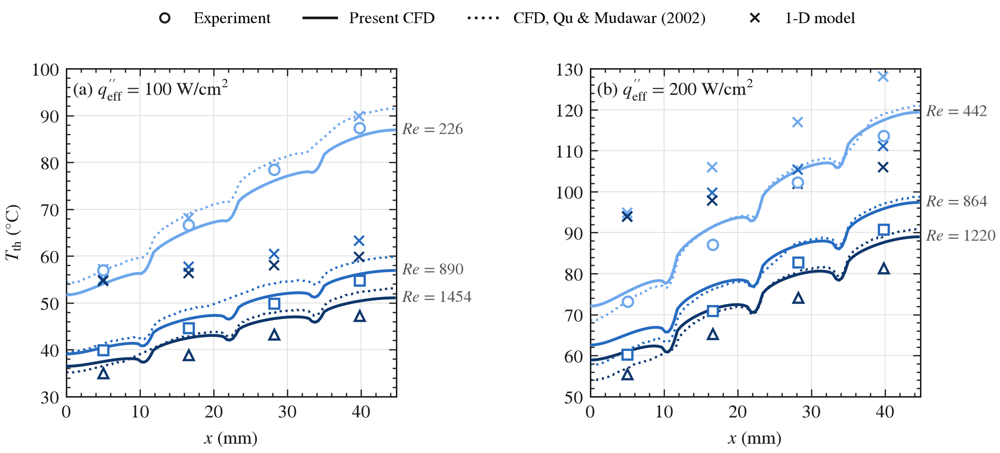
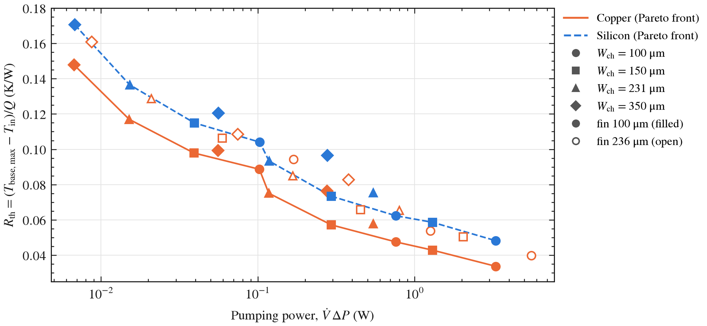
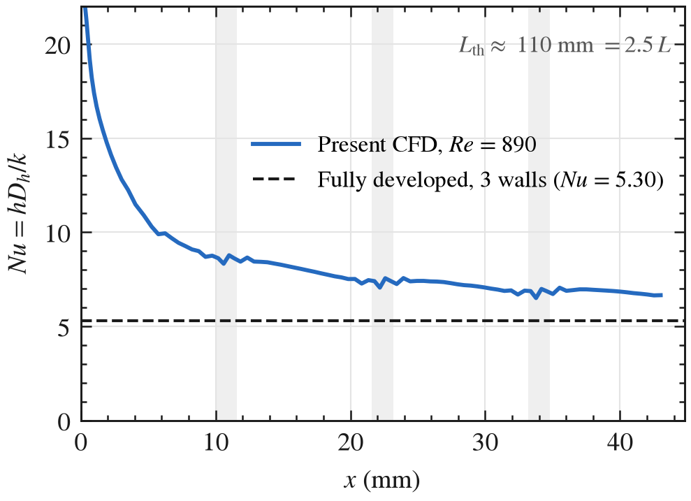
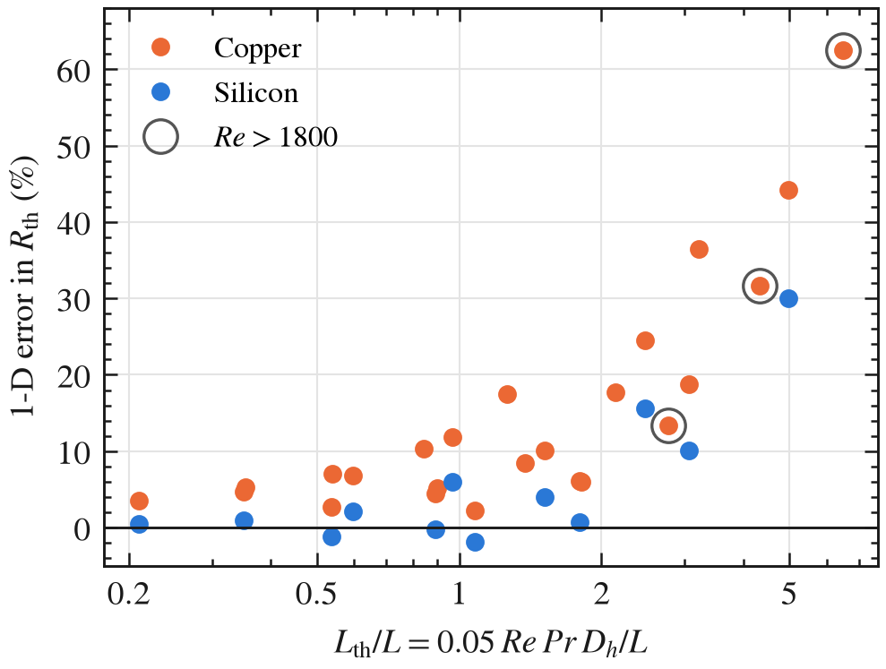

# Conjugate Heat Transfer Analysis of a Microchannel Cold Plate

Three-dimensional conjugate heat transfer (CHT) model of a single-phase copper microchannel heat sink, validated against the experiments of Qu and Mudawar (2002), verified with a grid convergence study and analytical theory, and used for a copper/silicon cold-plate design study at heat fluxes typical of high-power AI processors.

Tools: Ansys Fluent 2026 R1 (scripted with PyFluent), Ansys Icepak 2025 R2 (scripted with PyAEDT), Python (NumPy, SciPy, pandas, CoolProp, OpenCV, Matplotlib), LaTeX.

Report: [`report/report.pdf`](report/report.pdf)

## Results

| | |
|---|---|
| Validation, 6 operating points (Re = 226 to 1454; q″<sub>eff</sub> = 100 and 200 W/cm<sup>2</sup>) | thermocouple temperatures within 5.4 % of experiment (original CFD: 5.6 %); outlet energy balance within 1.5 % |
| Verification | three-mesh GCI below 1 % for ΔP and below 4.6 % for temperatures; isothermal ΔP extrapolates to within 0.1 % of the Shah and London solution |
| Thermally developing flow | mean CFD Nusselt number 9.0 vs 5.30 fully developed (three heated walls) at Re = 890; a fully developed 1-D model over-predicts R<sub>th</sub> by up to 62 %, with the error set by L<sub>th</sub>/L |
| Design study (36 cases, 448 W, 30 °C water) | thin fins and narrow channels form the Pareto front; best copper plate R<sub>th</sub> = 0.034 K/W for 3.3 W pumping power; silicon 15 to 35 % higher R<sub>th</sub> than copper at equal geometry |
| Multi-channel check (Icepak) | base temperature uniform across the plate width to 0.01 K, supporting the unit-cell model |

<p align="center"></p>

<p align="center"></p>

<p align="center"> </p>

## Method

- **Benchmark data.** Figures 4 to 7 of the paper digitised automatically (marker detection and curve tracing, calibrated on the axis ticks). Re values agree across figures within 0.2 %.
- **1-D model.** Shah and London f·Re and Hagenbach K(∞), a three-wall fully developed Nusselt number from a 2-D finite-volume solution (Nu = 5.30), fin efficiency and a resistance network.
- **CFD model.** Unit cell (one channel, two half fins, copper base, polycarbonate cover, the three air slots of the test section), structured hexahedral mesh written directly in Fluent format (orthogonal quality 1.0, 90 000 cells). Steady laminar flow; water μ, k and c<sub>p</sub> as functions of temperature; boundary conditions as in the paper; convergence judged on the reported quantities.
- **Design study.** Channel width (100 to 350 µm), fin width (100, 236 µm), flow rate (200 to 1000 ml/min) and material (copper, silicon), 1 mm base and lid, 100 W/cm<sup>2</sup>, 30 °C inlet, run as an automated PyFluent sweep.

Modelling choices and assumptions are listed in [`ASSUMPTIONS.md`](ASSUMPTIONS.md).

## Repository

```
analytical/       1-D model, 2-D fully developed Nu and f·Re solver, error tables
digitise/         extraction of the benchmark data from the paper's figures
data/digitised/   benchmark data (CSV)
cfd/              mesh generator, PyFluent case, validation, GCI, design sweep, field extraction
icepak/           multi-channel Icepak model (PyAEDT)
make_figures.py   all figures from the saved results
figures/          PNG and PDF figures
report/           LaTeX report
```

## Running

```powershell
python -m venv .venv
.venv\Scripts\pip install -r requirements.txt
cd cfd
..\.venv\Scripts\python mesh.py 1.0
..\.venv\Scripts\python case.py --mesh runs\unitcell_r1.msh --q 100 100 100 200 200 200 --re 226 890 1454 442 864 1220
..\.venv\Scripts\python compare_cfd.py
..\.venv\Scripts\python design_sweep.py
cd ..
.venv\Scripts\python make_figures.py
```

Ansys Fluent 2022 R2 or later is required; all meshes are below the 1 M-cell limit of the student licence. The benchmark paper is not included; it is available from the [authors' laboratory](https://engineering.purdue.edu/mudawar/files/articles-all/2002/2002_1.pdf) and is expected at `data/paper/QuMudawar2002_IJHMT.pdf` for the digitising step.

## Reference

W. Qu and I. Mudawar, "Experimental and numerical study of pressure drop and heat transfer in a single-phase micro-channel heat sink," *International Journal of Heat and Mass Transfer*, 45 (2002) 2549–2565.
